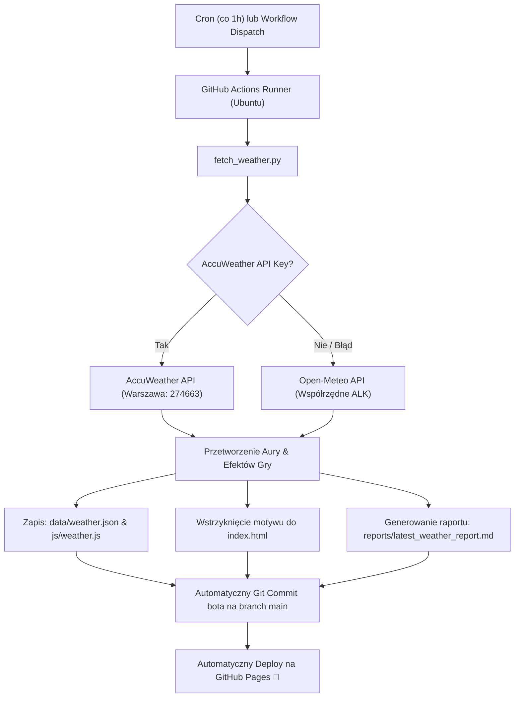

# 🎓 Kozminski Escape: Polowanie na ECTS & Dynamic Weather CI/CD 🌦️

> Dynamiczna gra retro-arcade 2D w murach **Akademii Leona Koźmińskiego (ALK)** w Warszawie, zintegrowana z autonomicznym robotem chmurowym **GitHub Actions**, który w czasie rzeczywistym monitoruje pogodę nad ul. Jagiellońską 57/59 i dynamicznie zmienia aurę, fizykę oraz interfejs gry na **GitHub Pages**!

---

## 🎮 1. Fabuła (Lore) i Zasady Gry

Trwa zimowa sesja egzaminacyjna na kampusie ALK. Korytarzami uczelni – od sal wykładowych Budynku D, przez korytarze, aż po legendarne **zielone Patio z pomnikiem Lwa** – krąży surowy **Profesor Egzaminator** uzbrojony w bezlitosny czerwony długopis.

### Cel gry:
* Zbierz **30 punktów ECTS**, aby zaliczyć semestr w pierwszym terminie i otrzymać wpis do indeksu z oceną Rektora (do 5.5).
* Uciekaj przed profesorem, który **przyspiesza z każdym zebranym przez Ciebie punktem ECTS**!

### Przedmioty i Mechaniki na Kampusie:
* 📜 **ECTS (+1 punkt)**: Indeksy i zaliczenia rozrzucone po aulach. Zbierz 30, aby wygrać!
* ☕ **Kawa z Bufetu ALK**: Błyskawicznie odnawia pasek staminy i daje potężne turbodoładowanie sprinterskie.
* 💻 **Gemini AI** / 📰 **Gazeta (Tryb Ultra-Retro '96)**:
  * *Tryb Nowoczesny (Gemini AI)*: Cybernetyczny paraliż sztucznej inteligencji zamraża profesora w bryle lodu na 3.5 sekundy.
  * *Tryb Ultra-Retro (Rocznik '96)*: Egzaminator rozkłada gazetę i zaczytuje się w notowaniach giełdowych, pozwalając studentom bezkarnie ściągać tuż obok niego za dodatkowe punkty!
* ⭐ **Złoty Lew Koźmińskiego (+3 ECTS)**: Rzadki bonus ukryty na zielonym Patio ALK.
* ⚡ **Sprint [Shift / Spacja]**: Umożliwia dynamiczną ucieczkę kosztem staminy.

---

## 🌦️ 2. Dynamiczny Silnik Pogodowy (GitHub Actions CI/CD)

Gra nie ma stałego tła ani stałych warunków atmosferycznych – **żyje w czasie rzeczywistym pogodą nad Warszawą (ul. Jagiellońska 57/59)**!



### Wpływ aury na rozgrywkę:
| Aura | Klasa CSS | Efekt graficzny na Canvasie | Cytat Profesora |
| :--- | :--- | :--- | :--- |
| **🌧️ Deszcz** | `.weather-rain` | Dynamiczne krople deszczu | *„Brrr, w taki deszcz moje arkusze ocen zamokną! Panie Kolego, zmykajmy do auli!”* |
| **☀️ Słońce** | `.weather-sunny` | Złociste refleksy i poświata | *„Piękna pogoda na zaliczenie w pierwszym terminie! Złapmy trochę słońca!”* |
| **❄️ Śnieg** | `.weather-snow` | Płatki śniegu unoszące się nad kampusem | *„Zaspy śnieżne na Jagiellońskiej, a ja muszę sprawdzić 150 egzaminów!”* |
| **☁️ / 🌙 Noc** | `.weather-night` | Chłodne, nastrojowe oświetlenie nocnej sesji | *„Gdzie podziały się arkusze z egzaminu z mikroekonomii?!”* |

---

## ⚙️ 3. Struktura Projektu

```text
starter_project/
├── .github/
│   └── workflows/
│       └── weather_pipeline.yml  # Autonomiczny potok CI/CD (Cron + workflow_dispatch)
├── css/
│   └── style.css                 # Stylizacja ALK, HUD, Ultra-Retro oraz dynamiczne motywy pogody
├── data/
│   └── weather.json              # Zrzut aktualnej aury pobranej przez bota
├── js/
│   ├── audio.js                  # Syntezator efektów dźwiękowych Web Audio API (8-bit)
│   ├── game.js                   # Główny silnik gry: fizyka, kolizje, AI ścigania, cząsteczki pogody
│   └── weather.js                # Obiekt window.CAMPUS_WEATHER ładowany dynamicznie
├── reports/
│   └── latest_weather_report.md  # Raport z ostatniego wykonania potoku CI/CD
├── fetch_weather.py              # Skrypt pobierający dane z AccuWeather / Open-Meteo
├── index.html                    # Szkielet HTML5 (HUD, Canvas 800x540, modale)
├── requirements.txt              # Zależności Python dla potoku CI/CD
└── README.md                     # Pełna dokumentacja projektu
```

---

## 🚀 4. Uruchomienie Lokalne i Testy

### Uruchomienie gry w przeglądarce:
Wystarczy otworzyć plik `index.html` w dowolnej nowoczesnej przeglądarce (lub uruchomić serwer lokalny, np. *Live Server* w VS Code).

### Ręczne przetestowanie silnika pogody (CLI):
```bash
# 1. Pobranie bieżącej aury z internetu (Open-Meteo fallback lub AccuWeather)
python fetch_weather.py --override auto

# 2. Wymuszenie deszczu (do testu cząsteczek i motywu ciemnoniebieskiego)
python fetch_weather.py --override rain

# 3. Wymuszenie słonecznej aury
python fetch_weather.py --override sunny

# 4. Wymuszenie śnieżycy
python fetch_weather.py --override snow
```

---

## 🔐 5. Konfiguracja w Repozytorium GitHub

1. **Włączenie uprawnień zapisu dla bota (wymagane dla commita)**:
   * Przejdź do: **Settings** &rarr; **Actions** &rarr; **General** &rarr; **Workflow permissions**.
   * Wybierz: 🔘 **Read and write permissions** i kliknij **Save**.
2. **Klucz AccuWeather API (opcjonalny)**:
   * Przejdź do: **Settings** &rarr; **Secrets and variables** &rarr; **Actions** &rarr; **New repository secret**.
   * Nazwa: `ACCUWEATHER_API_KEY`, Wartość: Twój klucz API.
   * *(Jeśli brak klucza, bot automatycznie przełącza się na darmowe i niezawodne Open-Meteo API)*.
3. **Ręczne wywołanie aury w GitHub Web UI**:
   * Przejdź do zakładki **Actions** &rarr; wybierz workflow **Kozminski Escape Live Weather Pipeline**.
   * Kliknij **Run workflow** i wybierz żądaną aurę z rozwijanej listy (`auto`, `rain`, `sunny`, `snow`, `night`).
